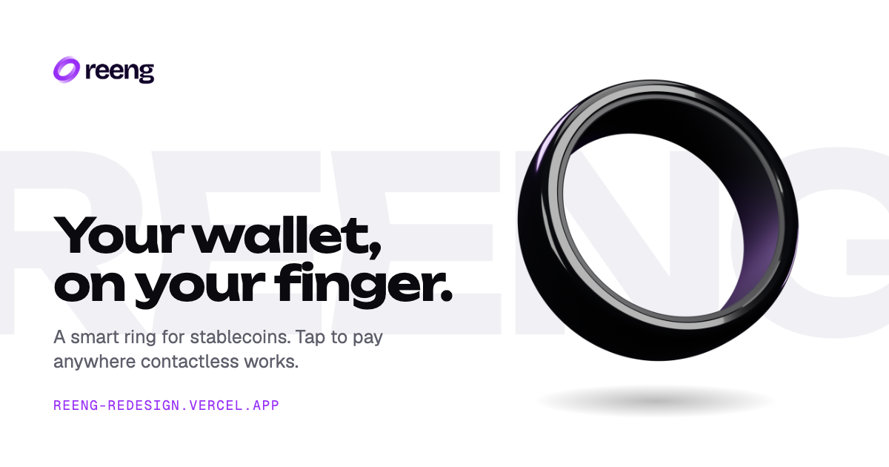
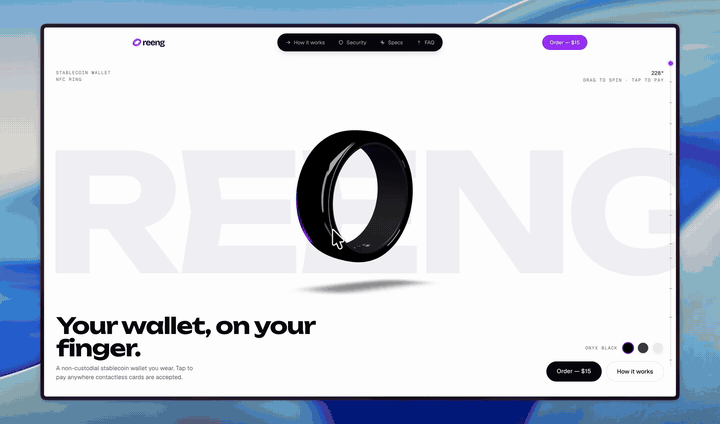
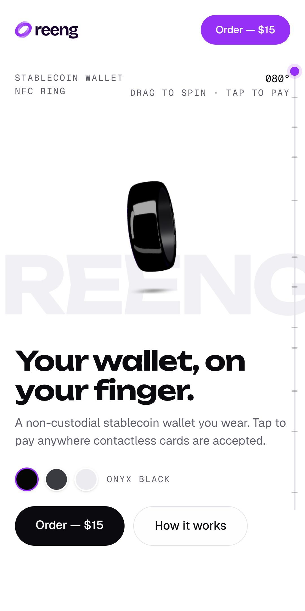
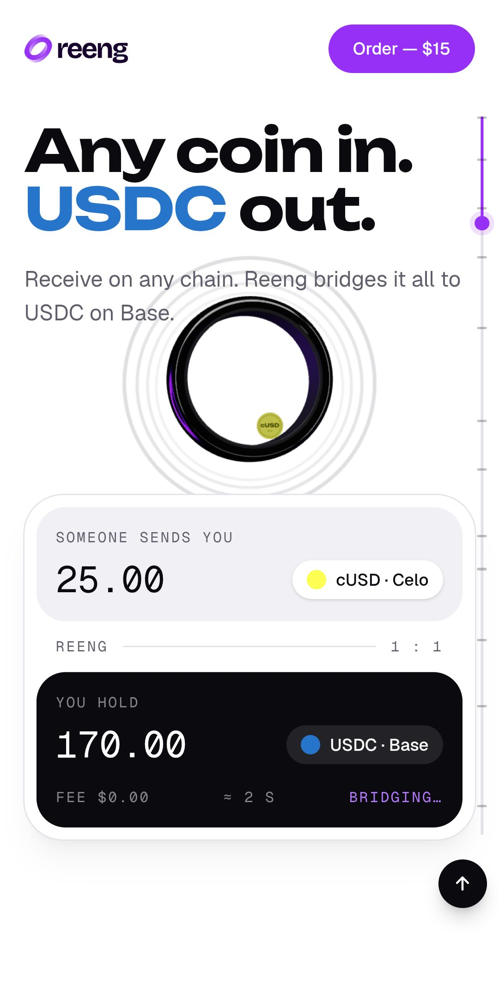
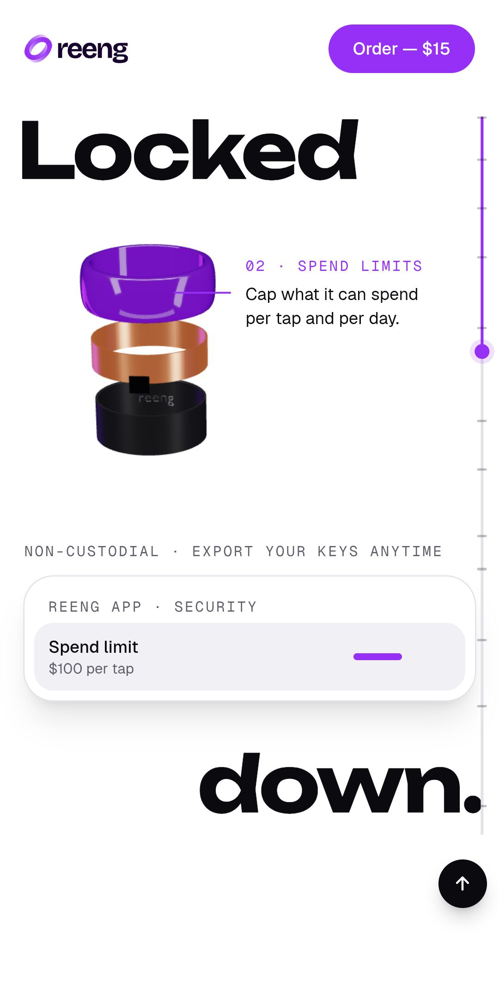
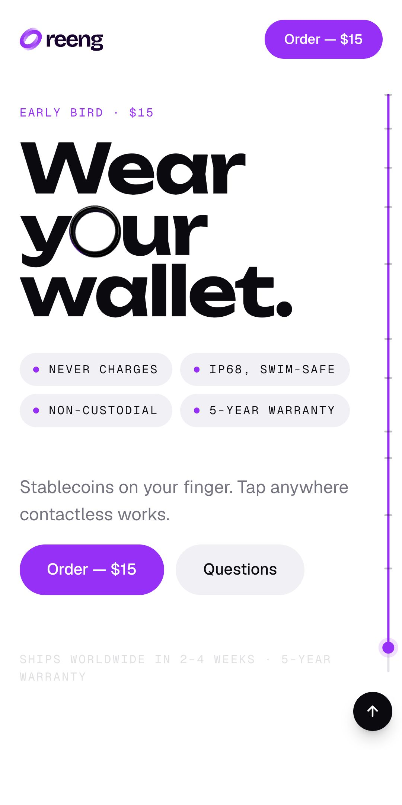

# Reeng redesign



**Live site:** [reeng-redesign.vercel.app](https://reeng-redesign.vercel.app)
**Role:** Research, design, 3D modelling and front-end development
**Timeline:** 5 days, 26 to 30 October 2026
**Type:** Self-initiated redesign of [reeng.xyz](https://reeng.xyz)

Reeng is a smart ring that works as a stablecoin wallet. You tap it to pay anywhere contactless works, receive money from any chain, and keep control of your own keys. I rebuilt its website around a real 3D model of the ring that you scroll through, so every feature is shown happening instead of being described. I also made sure it runs well on an ordinary phone, not only on my laptop.



<sub>Shown at double speed. [Watch the full walkthrough at normal speed](https://github.com/user-attachments/assets/39a21e05-d6b5-402f-a203-7839e5bf6009).</sub>

## The problem

Before designing anything, I went through every page of reeng.xyz and wrote down what I found (`research/RESEARCH.md`). Three things stood out.

- **The 3D was not real.** The hero ring was a 71-frame image sequence (1920×1080 WebP frames) played back as you scroll. That means a lot of images to download before the hero works, and the ring can only do what was rendered in advance. You can't spin it, recolour it, or take it apart.
- **There was no way to buy.** No price anywhere on the site, and "Order Now" led to a separate page with an "I'm interested" button. A visitor who was ready to buy had nowhere to go.
- **The features were told, not shown.** Tap to pay, any coin in USDC out, pay by email, spending limits, no charging. Each of these is a moment you can see, and the site explained them in paragraphs.

So the goal was clear: show the ring doing each of those things, give it a real order flow, and keep the whole page fast enough for a mid-range phone.

## Constraints I set

- **Same stack as the original site:** React 19, Vite, Tailwind v4, GSAP and React Router. That is so the team behind reeng.xyz could take the code over without learning a new setup. The only additions are three.js (through React Three Fiber) for the 3D and Lenis for smooth scrolling.
- **Text first, 3D second.** The page has to be readable the moment it loads. The 3D loads after, and it never blocks the content.
- **It has to work on low-end devices.** Every 3D decision was checked against what it costs on a phone GPU, and I tested on a real phone before calling it done.
- **Unconfirmed facts stay visible.** Some specs (water rating, materials, weight) aren't confirmed by the brand. They live in one file, marked `// assumed`, so nothing gets quietly presented as fact.

## Process

1. **Audit.** I documented the original site's product, stack, content and gaps before touching the design.
2. **The ring.** I built the ring in Blender from photo references, with a Python script (`3d/build_ring.py`) so it can be rebuilt any time. Its parts are named (Shell, Liner, Antenna, SecureChip) so the site can move them separately. The exported model is 80 KB with Draco compression.
3. **One section at a time.** For each of the 12 sections, I researched layouts on Mobbin, Dribbble and Pinterest, then built 3 to 5 working options as live pages, not static mockups. I reviewed each option on my laptop and on my phone, then picked one or combined two. The closing call to action, for example, combines the ring flying in as the "o" in "Wear your wallet." with the fact tags from another option, because the first one left the right side of the screen empty. The review pages were removed before launch and are still in the git history.
4. **Pace and polish.** Once every section was built, I scrolled through the whole page as a visitor would and fixed what slowed it down. More on that below.
5. **Real device testing.** I tested the live site on an Android phone over USB debugging and fixed what it turned up.

<p align="center">
  
  
  
  
</p>
<p align="center"><sub>Screenshots from the live site on a Samsung Galaxy S10e</sub></p>

## Key decisions and why

### A white page for a black ring

My first version of the rebuild was dark. I moved every section to a white, light theme, one section at a time. On white, the black ceramic ring is the darkest thing on the screen, so the eye goes to the product first, and the violet brand colour stands out instead of competing with a dark background. The 3D lighting is set up for this: the environment stays dark so the ceramic still reads as black, and large soft white lights give it its shine.

### One 3D scene for the whole page

There is a single 3D canvas fixed behind the page, not a separate one per section. The ring is the same object from top to bottom. It taps a payment terminal, lifts off and becomes a portal for coins, comes apart to show its security layers, drops into water, and lands as the "o" in the closing headline. A canvas per section would mean a dozen WebGL contexts, the model loaded a dozen times, and a ring that jumps instead of travels. With one scene, the browser keeps one context, the model loads once, and the story feels continuous.

### Scroll drives everything

Every animation follows the scroll position instead of playing on a timer or a tap. That is so the story moves at the reader's own speed, and scrolling back up plays it in reverse. Nothing runs ahead of the visitor, and nothing has to be replayed.

### Short sections that keep moving

The first pass of "Tap to pay" showed four payments across 480% of the screen's height. When I scrolled through it, I kept scrolling without seeing anything new after the first tap. So I cut every pinned section down to one clear demonstration:

| Section | Before | After |
|---|---|---|
| Tap to pay | 4 taps over 480svh | 1 tap over 220svh |
| Any coin in, USDC out | 6 coins over 300svh | 3 coins over 220svh |
| Pay by email | 3 coins over 300svh | 2 coins over 220svh |

While a section is pinned, its content now rises very slightly, 2.5% of the screen, so scrolling always looks like forward motion. I started at 6% and it moved the layout too much, so I brought it down until it was noticeable but not distracting.

### Content arrives as you reach it

Each component (a headline, a paragraph, a card, a list) fades in and rises on its own, starting the moment it crosses the bottom of the screen and finishing as it settles into place. My first version faded whole sections in at once, and it often finished before you saw it. Then I found that components resting low on the screen only had a few centimetres of scroll to fade in, so they popped. Every component now gets at least half a screen of scroll, and the animation eases between scroll steps so it glides instead of stepping with the mouse wheel.

### Interactions people already understand

- **A scrollbar that shows where you are.** A thin rail on the right fills violet as you scroll, with a tick at the start of each section. You can drag it or click it. A back-to-top button sits at its foot and only appears once you've scrolled past the first screen.
- **The ring you can handle.** In the hero and the order section, you can drag the ring to spin it. In the configurator, picking a size scales the ring true to its real inner diameter, and the finish swatches recolour the actual model.
- **A real order flow.** The order section walks through finish then size, with a "find your size" drawer, the price, and a checkout page. The original site had no price and no checkout at all.

### Content kept out of the components

Every piece of copy and every product fact lives in `src/content/`, not inside the components. When the price was confirmed at $20 with a $15 early-bird offer, it was a one-line change, and every button, panel and checkout total updated together. The FAQ answers are built from the same product file, so a spec change can't leave an old number in an answer.

## Making it fast on low-end devices

A 3D site can look great on a new laptop and struggle on a three-year-old phone. These are the decisions I made so the site works on both.

| Decision | Why | Result |
|---|---|---|
| A real 80 KB 3D model instead of a 71-frame image sequence | One small file can do everything the frames did, plus spinning, recolouring and taking the ring apart | The hero no longer waits on dozens of large images |
| Load the 3D after the page | Text and layout should never wait for the 3D engine | The page renders first, then the 3D loads in behind it |
| Keep three.js out of the main script | I found that importing one small math helper from three.js in a section pulled the whole engine, about 600 KB, into the main script | Main script cut from 908 KB to 529 KB (275 KB to 173 KB compressed) |
| Adaptive resolution | The canvas fills the screen and redraws every frame, so pixel count is the biggest cost | Capped at 1.75× pixel density, and a live monitor lowers it when frames drop and raises it when there's headroom |
| Edge smoothing stays on | Phones render the 3D below their screen's density, so without smoothing the ring showed jagged edges on my test phone | Clean edges at the same frame rate |
| No glass materials | The water bubbles used a glass-like material that renders the whole scene a second time every frame | A plain translucent material that looks nearly the same, with no second render |
| Shaders prepared during loading | Most objects start hidden, and the GPU otherwise prepares each one the first time it appears, mid-scroll | No stall when the terminal or the coins first appear |
| A shadow only where it's needed | The hero's soft shadow renders the scene again from below | It only runs while the hero is on screen, at a smaller size on weak devices |
| A scrollbar that doesn't re-render the page | Updating the interface 60 times a second while scrolling adds up on a slow phone | The rail writes its position directly, React only hears about rare changes |
| Respect reduced motion | Some visitors turn animation down in their system settings | Smooth scrolling switches off for them |

## Testing on a real phone

I connected a Samsung Galaxy S10e (a 2019 phone with an Adreno 640 GPU and 4 GB of memory, on Android 12) to my laptop and drove Chrome on it through USB debugging. A script reloaded the live site, scrolled the whole page at a steady speed, measured the frame rate in each section, took screenshots, and collected any console errors.

What it found:

- **The 3D looked jagged.** The phone has 4 GB of memory, so my quality settings treated it as a weak device and rendered the 3D at 1× resolution on a 2.6× screen, with smoothing off. It was holding 60 fps, so that was too cautious. I changed the threshold to devices under 4 cores or under 4 GB and kept smoothing on. The 3D now renders at 1.75× and still holds 58 to 60 fps in every section.
- **The back-to-top button covered the corner of a card** in the cross-chain section. I gave the card room above the button and moved the coin tunnel up so the card doesn't cover the ring.
- **A freeze I measured near the top of the page wasn't real.** It turned out to be my own test taking a screenshot just before scrolling, which stalls the phone's GPU. A fast scroll two seconds after load showed only one 50 ms frame.

The whole page, 3D included, transferred about 660 KB on first load, with no errors in the console.

## Sharing

When the link is shared, it shows a 1200×630 card with the ring and the headline. I rendered the ring in Blender in the same pose as the hero (`3d/render_og.py`), laid the card out in HTML with the site's fonts (`3d/og-card.html`), and captured it with headless Chrome, so it can be regenerated whenever the wording changes. The page has full Open Graph and X tags.

## What I'd do next

- **Connect a real checkout.** The checkout page is ready for Stripe, and it needs the brand's account to go live.
- **A fallback for devices without WebGL.** Still renders of each section from Blender would give those visitors the same story without the 3D.
- **Test on an iPhone.** I tested on Android only, so Safari on iOS is the next device to check.
- **Confirm the assumed specs** with the brand, so every number on the page is final.

## Built with

- **Front end:** React 19, TypeScript, Vite, Tailwind CSS v4, React Router
- **Motion:** GSAP with ScrollTrigger, Lenis smooth scroll
- **3D:** three.js, React Three Fiber, drei
- **3D modelling:** Blender, scripted in Python
- **Research:** Mobbin, Dribbble, Pinterest
- **Testing:** Chrome DevTools Protocol over USB debugging, headless Chrome
- **Hosting:** Vercel

## Running it locally

```bash
npm install
npm run dev        # http://localhost:5173
npm run build      # type-check, then production build into dist/
npm run preview    # serve the production build
```

To check it on a phone on the same network, run `npm run dev -- --host` and open the network address it prints.

| Path | What's in it |
|---|---|
| `src/sections/` | One file per section, in page order |
| `src/scene/` | The 3D scene, the ring's poses, and the quality settings (`quality.ts`) |
| `src/content/` | All copy and product data |
| `src/lib/` | Scroll tracking, reveals, smooth scroll |
| `3d/` | The Blender source, the ring build script, and the share card |
| `research/` | The original site audit, design direction and performance research |

One rule for anyone working on the code: page code must never import `three` at runtime. Use `import type` for types and the math helpers in `src/scene/scrollState.ts`, so the 3D engine stays out of the main script.
